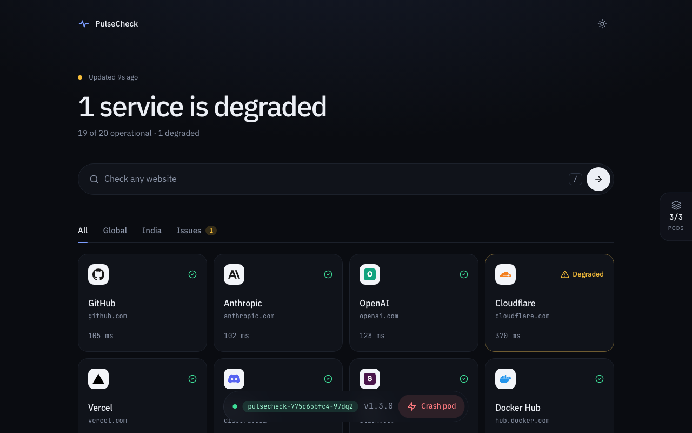
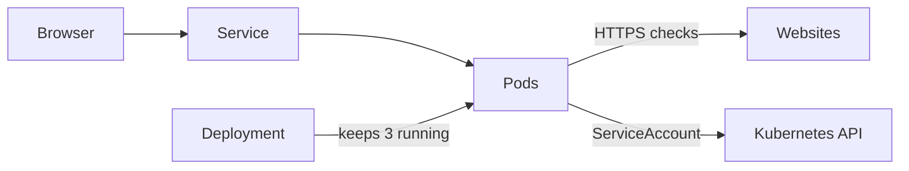
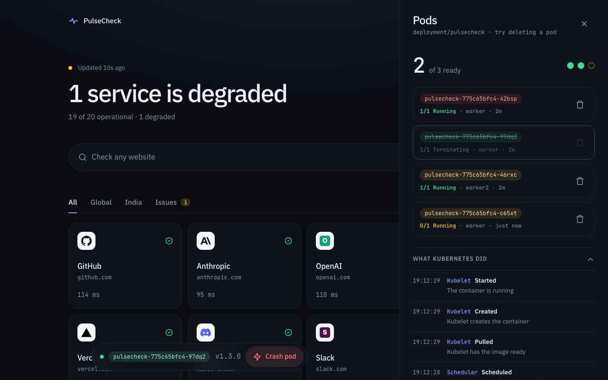
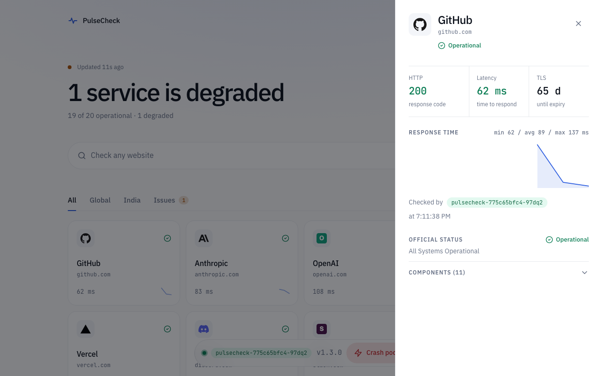
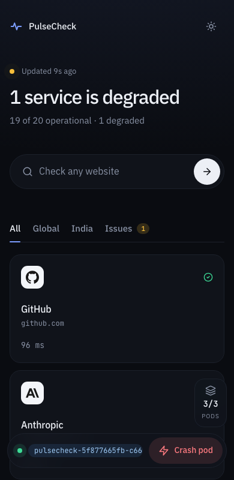

<div align="center">

# PulseCheck

**Watch popular services. Break pods on purpose. See Kubernetes fix them.**

[](https://hub.docker.com/r/trainwithshubham/pulsecheck)
[](https://hub.docker.com/r/trainwithshubham/pulsecheck)
[](LICENSE)



</div>

## What it does

- Checks 20 popular services, global and Indian, and any URL you type.
- Shows the pods that run it. Delete one and watch Kubernetes bring it back.
- Lists the real cluster events, so you can see who did what.

## Run it

**Docker**, on any machine:

```bash
docker run --rm -p 8888:8080 trainwithshubham/pulsecheck
```

Open http://localhost:8888. The pods view needs Kubernetes, so it stays hidden here.

**Kubernetes on your laptop**, with Docker, kind and kubectl:

```bash
git clone https://github.com/LondheShubham153/pulsecheck && cd pulsecheck
make preflight
make up
```

Open http://localhost:8888 and click the Pods tab on the right.

**Killercoda**, in the browser. Open the [Kubernetes playground](https://killercoda.com/playgrounds/scenario/kubernetes) and run:

```bash
git clone https://github.com/LondheShubham153/pulsecheck && cd pulsecheck
kubectl apply -f k8s/namespace.yaml
kubectl -n pulsecheck create configmap pulsecheck-catalog --from-file=app/catalog.yaml
kubectl apply -f k8s/rbac.yaml -f k8s/deployment.yaml -f k8s/service.yaml
```

Then open the Traffic / Ports menu and use port 30080.

## Build and push your own image

```bash
docker build -t YOU/pulsecheck:1.1.0 .
docker run --rm -p 8888:8080 YOU/pulsecheck:1.1.0
docker login
docker push YOU/pulsecheck:1.1.0
```

On a Mac with Apple Silicon, build for both chip types. A plain push gives an image that Killercoda cannot run.

```bash
docker buildx build --platform linux/amd64,linux/arm64 -t YOU/pulsecheck:1.1.0 --push .
```

`make push IMAGE=YOU/pulsecheck` does the same. Then change the three `image:` lines in `k8s/`.

## How it fits together



## Screenshots

<table>
  <tr>
    <td align="center"><br>A deleted pod comes back</td>
    <td align="center"><br>Service details</td>
    <td align="center"><br>Mobile</td>
  </tr>
</table>

## For your resume

- Built a stateless FastAPI uptime monitor that checks 20 services and any URL, with an SSRF guard, health checks and Prometheus metrics.
- Ran it on a 3 node kind cluster with a Deployment, a Service and RBAC, and built a live view of pods and cluster events.

Teaching notes are in [RUNBOOK.md](RUNBOOK.md). Released under the [MIT License](LICENSE).

Made by [TrainWithShubham](https://trainwithshubham.com/?utm_source=pulsecheck-github).
